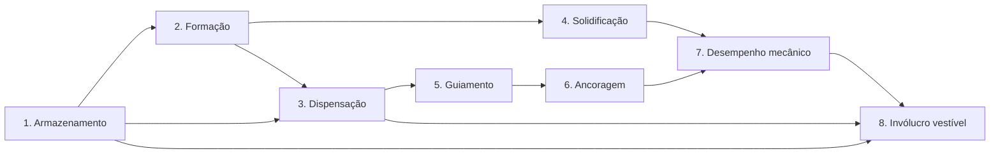

# S1 — Avaliação de viabilidade e revisão de literatura

| Campo | Valor |
|---|---|
| Projeto | Miranha de P.A. (v0.1.0, `concept_development`) |
| Documento | S1 — revisão de literatura e viabilidade, com prévia de S2 e S3 |
| Versão / data | 0.1 — 29/10/2026 |
| Status | Rascunho técnico para revisão da equipe |
| Documentos associados | [Bibliografia anotada](bibliografia_anotada.md) · [Registro de riscos](registro_de_riscos.md) · [Protocolo S3 / experimento E1](protocolo_S3_bancada.md) · [Matriz de materiais](../dados/matriz_materiais_preliminar.csv) · [Cálculos de ordem de grandeza](../analises/ordens_de_grandeza.py) |

---

## 0. Como ler este documento

### 0.1 Rótulos de evidência

Cada afirmação relevante recebe um dos rótulos abaixo.

| Rótulo | Significado |
|---|---|
| **[D]** | **Demonstrado experimentalmente** em publicação revisada por pares |
| **[L]** | **Suportado pela literatura, mas dependente de contexto** (espécie, processo, condição de ensaio) ou baseado em compilações e fontes secundárias |
| **[T]** | **Teórico**: cálculo de ordem de grandeza ou simulação, com hipóteses declaradas |
| **[E]** | **Especulativo**: sem evidência direta; hipótese a testar |

Na [matriz de materiais](../dados/matriz_materiais_preliminar.csv), a coluna `tipo_dado` separa **medido**, **compilado**, **estimativa** e **lacuna**.

### 0.2 Limitações desta revisão

- As referências e os valores numéricos foram conferidos por buscas na web (metadados, resumos e tabelas visíveis). **Os textos completos não puderam ser abertos nesta sessão**, porque os domínios `nature.com`, `pmc.ncbi.nlm.nih.gov` e `sicb.org` estavam bloqueados pela política de rede do ambiente. Os itens marcados como "conferir" na [bibliografia](bibliografia_anotada.md) precisam ser checados no original antes de qualquer uso externo.
- É uma revisão narrativa e direcionada, não uma revisão sistemática.
- Valores de fontes diferentes **não são diretamente comparáveis**. Eles dependem da taxa de deformação, do comprimento de referência, da umidade, do método usado para medir a seção transversal e da origem da seda (fiação natural ou forçada).

### 0.3 Terminologia

| Termo | Definição | Unidade |
|---|---|---|
| Resistência à tração (σ_rup) | Tensão nominal na ruptura | GPa, MPa |
| Deformação na ruptura (ε_rup) | Alongamento na ruptura / comprimento inicial | adimensional ou % |
| Módulo inicial (E) | Inclinação inicial da curva tensão–deformação | GPa |
| **Tenacidade** | Energia absorvida até a ruptura por unidade de volume (área sob a curva tensão–deformação), em inglês *toughness* | MJ/m³ |
| **Resistência específica** | Força de ruptura ÷ densidade linear. Na indústria têxtil também se chama "tenacidade"; aqui usamos "resistência específica" para evitar ambiguidade | N/tex, cN/tex |
| tex | Densidade linear: 1 tex = 1 g/km = 10⁻⁶ kg/m. A massa, em mg, de 1 m de fio é numericamente igual ao tex | g/km |
| Fluência | Deformação crescente sob carga constante ao longo do tempo | %, s |
| Seda MA | Seda da glândula ampolada maior: o "fio de ancoragem" (*dragline*) | — |

Conversões úteis: **σ [GPa] = resistência específica [N/tex] × ρ [g/cm³]**, ou σ [MPa] = [cN/tex] × ρ [g/cm³] × 10. 1 N/tex = 1 MJ/kg. Tenacidade por massa [J/g] = tenacidade [MJ/m³] ÷ ρ [g/cm³].

---

## 1. Sumário executivo

**Conclusão central.** O objetivo primário, uma fibra sintética inspirada na seda de aranha, é uma linha de pesquisa legítima e ativa. Até agora, porém, o desempenho do fio de ancoragem só foi reproduzido em laboratórios especializados, com proteínas recombinantes e fiação controlada **[D]** (Bowen et al. 2018). O objetivo de longo prazo, um dispositivo de pulso que forma e lança um filamento, é **especulativo [E]**. Ele esbarra em limites físicos que independem da qualidade da fibra: a seda natural é *estirada*, não *ejetada* **[L]**; filamentos espessos levam minutos para solidificar por difusão, não frações de segundo **[T]**; e ancoragem e cargas dinâmicas são problemas separados **[L]**.

**Principais achados**

1. ***Theraphosa blondi* não é uma boa referência.** É uma migalomorfa (tarântula). **Não localizamos nenhum dado mecânico revisado por pares para a seda dessa espécie.** O único valor encontrado para outra terafosídea (*Grammostola rosea*, resumo de congresso) é ~0,15 GPa, cerca de 15 % do fio de ancoragem de araneomorfas **[L, baixa confiança]**. A filogenia indica que os ganhos de resistência e tenacidade surgiram dentro das araneomorfas **[D]** (Blackledge et al. 2012). Além disso, a espécie incorpora cerdas urticantes em suas construções de seda **[D]** (Marshall & Uetz 1990). O tamanho do corpo não determina a resistência do material: a tensão de ruptura é uma propriedade intensiva **[L]**.
2. **Referências recomendadas:** seda MA de *Araneus diadematus* e *Trichonephila* (ex-*Nephila*) spp., as mais caracterizadas; *Argiope* spp., referência usada por grupos de seda recombinante; *Caerostris darwini*, extremo de tenacidade (~350 MJ/m³ em média) **[D]**; e seda de *Bombyx mori*, referência física acessível e comprável **[L]**.
3. **Não existe "melhor material" universal.** Em resistência específica, UHMWPE e para-aramida superam a seda MA por um fator de ~3–4 **[L]**. Em tenacidade, a seda MA (~100–350 MJ/m³) supera ambas (~50–60 MJ/m³) **[L/D]**. Em estabilidade à umidade, os sintéticos vencem: a seda MA pode supercontrair até ~50 % na água quando livre **[D]**. Em resistência específica, o náilon 6,6 é comparável à seda MA de *A. diadematus* (0,83 vs 0,85 N/tex, valores derivados de compilação) **[T]**.
4. **"Exposição ao ar" não forma uma fibra resistente.** Os mecanismos reais são a acidificação, a troca iônica, o fluxo extensional e o estiramento (seda) **[D]**; a fusão seguida de estiramento (náilon, PET) **[D]**; a fiação em gel com ultraestiramento (UHMWPE) **[D]**; e a coagulação em banho (aramida, fibroína regenerada, alginato) **[D]**. A evaporação só é eficaz em diâmetros micrométricos e combinada com estiramento **[D/T]**.
5. **Um filamento bem-sucedido não torna o lançador viável.** Ranking dos desafios (Seção 7.3): (1) formação in situ; (2) energia de projeção com segurança; (3) ancoragem; (4) cargas dinâmicas; (5) estabilidade do precursor armazenado.

**Direção mais promissora.** Dividir o projeto em duas trilhas e adiar o dispositivo vestível:

- **Trilha A, caracterização (agora).** Desenvolver competência de medição com fibras comerciais (seda de *B. mori*, náilon, poliéster, UHMWPE, para-aramida) em ensaios estáticos, protegidos e de baixa energia. Sem essa base, nenhuma fibra nova poderá ser avaliada com credibilidade.
- **Trilha B, formação (depois de S3).** Estudar um mecanismo de solidificação seguro e bem documentado, a gelificação iônica de alginato em banho de Ca²⁺, para aprender relações entre processo e propriedade (estiramento × resistência). Fibroína regenerada e espidroínas recombinantes ficam restritas a um laboratório parceiro.
- **Conceito vestível.** Reformular como "dispensador de filamento pré-formado" (carretel), removendo a formação in situ.

**Próximo experimento (E1).** Caracterização comparativa, por carregamento estático incremental, de cinco fios comerciais finos com carga de ruptura ≤ 50 N. O ensaio mede a densidade linear por pesagem e o alongamento por vídeo, registra temperatura e umidade, usa n ≥ 10 por material e inclui um subensaio de fluência. A energia elástica armazenada por corpo de prova é da ordem de 1 J ou menos (~0,15 J para um fio de náilon de 15 N) **[T]**. Detalhes em [protocolo_S3_bancada.md](protocolo_S3_bancada.md).

---

## 2. Avaliação científica de viabilidade

| # | Proposição | Avaliação | Evidência | Viabilidade |
|---|---|---|---|---|
| 1 | Já existe fibra artificial com resistência e tenacidade comparáveis às do fio de ancoragem? | Sim, em laboratório especializado. Espidroína recombinante de 556 kDa: 1,03 ± 0,11 GPa e 114 ± 51 MJ/m³ (Bowen et al. 2018). Seda de aranha produzida por bicho-da-seda transgênico: 1,3 GPa e 319 MJ/m³ (Mi et al. 2023, valores vistos só em cobertura de imprensa; conferir). Variabilidade alta; custo e escala limitantes. | [D] | Demonstrada, fora do alcance de bancada |
| 2 | Reproduzir esse resultado em bancada, sem parceiro institucional | Exige expressão e purificação de proteína, controle de pH e íons, fiação e pós-estiramento. Envolve OGM (regulação pela CTNBio). | [L] | Não viável no curto prazo |
| 3 | Fibra bioinspirada sintética (não proteica) com alta tenacidade | Demonstrada em laboratório: hidrogel PAA/sílica com 0,895 GPa e 370 MJ/m³ (Dou et al. 2019). Sensibilidade à umidade e escalabilidade não estabelecidas. | [D] com ressalvas | Promissora para pesquisa; imatura |
| 4 | Líquido que vira fibra resistente por exposição ao ar | Contraria a cinética de difusão para diâmetros acima de ~10–50 µm em tempos < 1 s e não fornece estiramento nem orientação molecular (Seção 6.2). | [T] | Não viável |
| 5 | Dispensar continuamente uma fibra pré-formada, de forma controlada | Tecnologia madura (indústria têxtil, carretéis, controle de tensão). | [D] em outros contextos | Viável |
| 6 | Dispositivo de pulso que forma e lança filamento | Depende de 1 a 5 e, além disso, de ancoragem, de energia de projeção segura e de cargas dinâmicas. | [E] | Não viável com o conhecimento atual |
| 7 | Suporte do peso humano por filamento experimental | Fora do escopo por segurança. Nenhuma inferência é possível a partir de ensaios estáticos (Seção 8). | — | Não avaliado; proibido testar |

---

## 3. Estrutura molecular da seda de aranha e mecanismo de fiação

### 3.1 Qual seda importa

Aranhas orbitelas (araneomorfas) têm vários tipos de glândulas de seda, cada um com proteínas e propriedades próprias **[L]**. Para resistência e tenacidade, a referência é a **seda da glândula ampolada maior (MA)**, o fio de ancoragem usado como linha de segurança e na estrutura da teia. A espiral de captura (seda flageliforme) é muito extensível (ε_rup ≈ 2,7), mas pouco rígida (E ≈ 3 MPa). Ela é relevante para absorver energia, não para sustentar carga **[L]** (Gosline et al. 1999).

### 3.2 Hierarquia estrutural

**Nível 1: sequência (espidroínas MA).** As espidroínas MaSp1 e MaSp2, além de parálogos como a MaSp3, foram associadas ao alto desempenho em um levantamento com 1098 espécies sequenciadas e 446 ensaiadas (Arakawa et al. 2022) **[D]**. São proteínas grandes, da ordem de centenas de kDa, com um núcleo repetitivo flanqueado por domínios terminais não repetitivos (NT e CT).

| Motivo / domínio | Estrutura formada | Função mecânica | Evidência |
|---|---|---|---|
| Blocos de polialanina (A)ₙ / (GA)ₙ, ~8–10 resíduos | Nanocristais de folha-β | Rigidez e resistência; funcionam como reticulações físicas da rede | [D]/[L] (Gosline et al. 1999) |
| Blocos ricos em glicina (GGX), ~24–35 resíduos | Regiões menos ordenadas (hélices, voltas) | Extensibilidade; matriz que redistribui a carga | [L] |
| Motivo GPGXX (MaSp2, com prolina) | Voltas-β, segmentos elásticos | Extensibilidade e supercontração. O surgimento da MaSp2 acompanha o aumento de tenacidade nas orbitelas | [L] (Blackledge et al. 2012) |
| Domínio N-terminal (NT) | Dimeriza em pH ácido | "Trava": liga as espidroínas em rede durante a fiação e mantém a solubilidade no armazenamento | [D] (Andersson et al. 2014) |
| Domínio C-terminal (CT) | Desestabiliza em pH ácido e forma estrutura β do tipo amiloide | "Gatilho": nucleia a polimerização em fibra | [D] (Andersson et al. 2014) |

**Nível 2: nanoestrutura.** Nanocristais β de poucos nanômetros ficam embebidos em uma matriz menos ordenada, ligada por pontes de hidrogênio. Simulações de dinâmica molecular indicam que cristais com menos de ~3 nm são mais rígidos, resistentes e tenazes, porque o cisalhamento faz as pontes de hidrogênio trabalharem em conjunto (Keten et al. 2010) **[T: simulação; o tamanho ótimo não foi medido diretamente]**.

**Nível 3: fibrilas e fibra.** A fibra é formada por nanofibrilas orientadas ao longo do eixo, tem estrutura pele–núcleo e diâmetro de poucos micrômetros **[L]**. Em uma reanálise de 164 espécies, a orientação molecular, medida por birrefringência, acompanhou a resistência e a tenacidade mais de perto do que a cristalinidade (Wolff 2024) **[D]**.

### 3.3 Papéis dos nanocristais e das regiões menos ordenadas

- **Nanocristais β.** Sustentam a tensão em cargas altas e funcionam como reticulações físicas. O rompimento e a reformação das pontes de hidrogênio sob cisalhamento (deslizamento tipo *stick-slip*) contribuem para resistência e dissipação **[L/T]**.
- **Regiões menos ordenadas.** Desenrolam-se e alinham-se sob tração, o que dá extensibilidade, e dissipam energia por histerese, o que dá tenacidade e amortecimento **[L]**.
- **Princípio transferível:** uma *fase dura dispersa, conectada por uma matriz macia e orientada por estiramento*. O que se transfere é esse princípio, não a sequência proteica em si.

### 3.4 Como a aranha forma a fibra e por que isso importa

1. **Armazenamento.** Um dope aquoso muito concentrado de espidroínas fica em fase líquido-cristalina (Vollrath & Knight 2001) **[D]**. Minispidroínas projetadas atingem solubilidade de ~500 mg/mL em condições que imitam o lúmen da glândula (Schmuck et al. 2021) **[D]**.
2. **Duto de fiação.** Ocorrem troca iônica e acidificação de pH ~7,6 para ~5,7, gerada por anidrase carbônica (Andersson et al. 2014) **[D]**. O NT "trava" a rede e o CT "dispara" a polimerização.
3. **Fluxo e retirada de água.** O duto afilado impõe fluxo extensional. A transição de solução para sólido é desencadeada quando o trabalho de fluxo supera um limiar. Esse "*aquamelt*" exige pelo menos 10 vezes menos trabalho do que um polímero fundido típico (Holland et al. 2012) **[D]**. Um mecanismo análogo foi reproduzido com solução aquosa de poli(óxido de etileno) (Dunderdale et al. 2020) **[D]**.
4. **Estiramento externo.** A fibra é **puxada** pelo peso do corpo ou pelas pernas, a ~10–20 mm/s durante a construção da teia (Shao & Vollrath 2002) **[L]**. Velocidade e temperatura de fiação alteraram todas as propriedades mecânicas medidas em *Nephila edulis*, na faixa de 0,1–400 mm/s e 5–40 °C (Vollrath, Madsen & Shao 2001) **[D]**.

**Consequências de projeto**

- **A seda é um produto de processo.** A mesma proteína gera fibras fracas ou fortes conforme a fiação **[D]**. Em fibras recombinantes, bobinamento rápido e pós-estiramento foram os fatores mais importantes para a resistência, em um estudo com mais de 1000 fibras e 92 condições (Greco et al. 2022, *Commun. Mater.*) **[D]**.
- **A solidificação é química e mecânica.** O ar não é o agente **[D]**.
- **Diâmetros micrométricos** são condição para uma desidratação rápida (Seção 6.2) **[T]**.

### 3.5 Limitações ambientais e de variabilidade da seda

- **Supercontração.** Em umidade alta, fibras MA livres podem encurtar até ~50 %, e fibras restringidas desenvolvem tensão. Depois da supercontração e da secagem, a rigidez e a tensão de escoamento caem (Blackledge et al. 2009) **[D]**. É um problema sério de estabilidade dimensional.
- **Radiação UV** degrada as propriedades mecânicas da seda **[L]** (ver bibliografia).
- **Variabilidade.** O desvio padrão relativo de resistência e de deformação na ruptura fica entre 10 e 50 %, e não diminui com mais amostras. Ensaiar 10 fibras por tipo foi considerado representativo (Greco et al. 2022, *Sci. Rep.*) **[D]**. Há variação entre espécies, entre indivíduos e dentro do mesmo indivíduo (Madsen et al. 1999) **[L]**.

### 3.6 Quais mecanismos podem ser reproduzidos com polímeros sintéticos

| Mecanismo biológico | Análogo sintético | Status |
|---|---|---|
| Fase dura cristalina + matriz macia | Polímeros semicristalinos estirados (náilon); elastômeros segmentados com segmentos duros ligados por pontes de H (poliuretanos, poliureias) | Princípio [D]; desempenho tipo seda em elastômeros segmentados [L], dados não verificados nesta revisão |
| Ligações de sacrifício que dissipam energia | Hidrogéis com dopagem iônica; química hospedeiro–hóspede | [D] em laboratório (Dou et al. 2019; Wu et al. 2017) |
| Orientação por fluxo extensional + estiramento | Fiação por fusão ou solução com estiramento a quente; pultrusão de géis | [D] industrial |
| Fiação a partir de fase líquido-cristalina | Para-aramida, fiada de solução líquido-cristalina em ácido sulfúrico | [D] industrial; processo perigoso |
| Solidificação por fluxo de solução aquosa (*aquamelt*) | Poli(óxido de etileno) aquoso | Fenômeno [D] (Dunderdale et al. 2020); fibra de desempenho [E] |
| Montagem por domínios terminais sensíveis a pH | Só com proteínas (espidroínas recombinantes) | [D] em laboratório especializado |
| Estrutura pele–núcleo | Fiação coaxial ou bicomponente | [D] industrial |
| Hierarquia completa, processo aquoso à temperatura ambiente | — | [E]: não reproduzida integralmente por nenhum sistema sintético |

---

## 4. Espécie de referência: *Theraphosa blondi*

### 4.1 O que a literatura indica

- É uma migalomorfa (tarântula) que usa seda para revestir a toca, nas ootecas e nos tapetes de muda **[L]**. Incorpora cerdas abdominais urticantes às ootecas e aos tapetes de muda, como defesa (Marshall & Uetz 1990, sob o nome *T. leblondi*) **[D]**.
- Migalomorfas e mesotelas têm uma biologia de seda mais simples. Muitas duplicações de genes de espidroína ocorreram depois da separação entre mesotelas e opistotelas (migalomorfas + araneomorfas) (Starrett et al. 2012) **[D]**.
- Uma análise filogenética padronizada por supercontração mostra ganhos de resistência após a origem dos motivos GGX e de maior repetitividade, com máximo em entelegínas basais (~230 milhões de anos). A tenacidade aumentou depois, nas orbitelas, com a origem da MaSp2 (Blackledge et al. 2012) **[D]**. Uma das buscas indicou trabalho de ruptura ~10 vezes menor para a seda de tarântula do que para a seda MA de orbitelas. **Conferir no texto completo.**
- O único dado de terafosídea localizado é o de *Grammostola rosea*: ~0,15 GPa, ~11 % de alanina e apenas cerca de metade dela em conformação β (resumo de congresso) **[L, baixa confiança]**.
- Wolff (2024) encontrou desempenho excepcional tanto dentro quanto fora do clado das araneoides, e nenhuma diferença entre guildas ecológicas **[D]**. Portanto, a escolha da referência deve se basear em dados medidos, não em ecologia nem em tamanho.
- **Nenhum dado mecânico revisado por pares foi localizado para a seda de *T. blondi*.** Isso é uma lacuna.
- **Exemplo de cautela:** a alegação de que tarântulas secretam seda pelos pés (Gorb et al. 2006) foi contestada. As estruturas interpretadas como fiandeiras seriam quimiorreceptores (Foelix et al. 2012), e experimentos com as fiandeiras abdominais seladas não encontraram seda nos pés (Pérez-Miles et al.; conferir referência) **[L: controvérsia aberta]**.

### 4.2 A espécie fornece evidência relevante para as propriedades desejadas?

**Não.** Um corpo maior permite um fio mais grosso, e portanto uma força de ruptura maior, mas a *resistência do material* (tensão) é uma propriedade intensiva que não cresce com o tamanho do animal **[L]**. Não há dados mecânicos da espécie, e sua linhagem não possui o sistema de seda MA especializado que define o estado da arte. Somado ao risco das cerdas urticantes, recomenda-se:

| Papel | Espécie / material | Justificativa |
|---|---|---|
| Referência primária de desempenho | Seda MA de *Araneus diadematus* e *Trichonephila* (ex-*Nephila*) spp. | As mais caracterizadas em mecânica e sequência |
| Referência da comunidade de seda recombinante | *Argiope* spp. | Comparação direta em Andersson et al. 2017 |
| Extremo de tenacidade | *Caerostris darwini* | ~350 MJ/m³ em média, até 520 MJ/m³ (Agnarsson et al. 2010) |
| Referência física acessível | Seda de *Bombyx mori* (comercial) | Comprável e ensaiável em bancada |
| Contraste ("seda simples") | Terafosídeas, incluindo *T. blondi* | Somente literatura; sem animais vivos |

**Observação regulatória (a confirmar com a instituição):** no Brasil, usar sequências ou amostras de espécies nativas é acesso ao patrimônio genético e exige cadastro no SisGen (Lei nº 13.123/2015). Trabalhar com organismos geneticamente modificados, como na expressão de espidroínas, exige Certificado de Qualidade em Biossegurança (CQB) junto à CTNBio (Lei nº 11.105/2005).

---

## 5. Comparação de materiais candidatos

### 5.1 Propriedades documentadas

Fonte completa, com condições de ensaio e status de verificação: [dados/matriz_materiais_preliminar.csv](../dados/matriz_materiais_preliminar.csv). "n/v" = não verificado nesta revisão; "—" = não informado.

| Material | σ_rup (GPa) | ε_rup | E (GPa) | Tenacidade (MJ/m³) | ρ (g/cm³) | Tipo de dado | Fonte |
|---|---|---|---|---|---|---|---|
| Seda MA, *A. diadematus* | 1,1 | 0,27 | 10 | 160 | 1,3* | compilado [L] | Gosline et al. 1999 |
| Seda MA, *C. darwini* | n/v | n/v | n/v | 350 (máx. 520) | — | medido [D] | Agnarsson et al. 2010 |
| Seda MA, *A. trifasciata* | 0,89 ± 0,13 | — | — | 100 ± 40 | — | medido [D] | Andersson et al. 2017 (supl.) |
| Seda, *G. rosea* (terafosídea) | ~0,15 | — | — | — | — | resumo [L, baixa] | Moore et al. (SICB) |
| Seda, *T. blondi* | **lacuna** | | | | | | |
| Seda de casulo, *B. mori* | 0,6 | 0,18 | 7 | 70 | 1,3* | compilado [L] | Gosline et al. 1999 |
| Espidroína recombinante 556 kDa | 1,03 ± 0,11 | 0,18 ± 0,06 | 13,7 ± 3,0 | 114 ± 51 | — | medido [D] | Bowen et al. 2018 |
| Minispidroína NT2RepCT (como fiada) | 0,162 ± 0,008 | 0,37 ± 0,05 | 6 ± 0,8 | 45 ± 7 | — | medido [D] | Andersson et al. 2017 |
| Seda de aranha por bicho-da-seda transgênico | 1,299 | — | — | 319 | — | imprensa [L] | Mi et al. 2023 |
| Hidrogel PAA/sílica, núcleo–casca, torcido | 0,895 | 0,443 | — | 370 | — | medido [D] | Dou et al. 2019 |
| Náilon 6,6 (fibra) | 0,95 | 0,18 | 5 | 80 | 1,14 | compilado [L] | Gosline et al. 1999 |
| Para-aramida (Kevlar 49) | 3,6 | 0,027 | 130 | 50 | 1,44 | compilado [L] | Gosline et al. 1999 |
| UHMWPE (Dyneema/Spectra) | 3,0–3,9 | 0,025–0,045 | 100–125 | ~56 (estimada) | 0,97 | secundário / estimativa | fichas técnicas (conferir) |
| Aço de alta resistência | 1,5 | 0,008 | 200 | 6 | 7,8 | compilado [L] | Gosline et al. 1999 |
| Alginato de cálcio fiado a úmido | 14,1 cN/tex (seco); 3,46 cN/tex (úmido) | — | — | — | — | medido [D] | *J. Appl. Polym. Sci.* 2006 |

\* Densidade assumida (valor usual). Os valores de Gosline et al. 1999 vêm da Tabela 1 e devem ser conferidos no original. A tenacidade do UHMWPE foi estimada por σ²/(2E), supondo comportamento elástico-linear.

**Valores derivados por massa** **[T]**, calculados a partir dos valores compilados acima:

| Material | Resistência específica (N/tex) | Tenacidade por massa (J/g) |
|---|---|---|
| Seda MA, *A. diadematus* | 0,85 | 123 |
| Náilon 6,6 | 0,83 | 70 |
| Seda de *B. mori* | 0,46 | 54 |
| Para-aramida | 2,5 | 35 |
| UHMWPE | ~3,6 | ~58 (estimada) |
| Aço de alta resistência | 0,19 | 0,8 |

Leitura: a vantagem distintiva da seda MA está na **energia absorvida por massa**, não na resistência por massa.

### 5.2 Matriz qualitativa por classe de material

Escala: A = alto/favorável, M = médio, B = baixo/desfavorável. Avaliação qualitativa **[L]**, a refinar em S2.

| Classe | Mecânica | Disponibilidade | Complexidade de fabricação | Equipamento | Estabilidade ambiental | Toxicidade / irritação no processo | Custo | Reprodutibilidade |
|---|---|---|---|---|---|---|---|---|
| A. Sintéticas comerciais (náilon, PET, UHMWPE, para-aramida) | A em resistência; tenacidade variável | A | Nenhuma (compradas) | B (só para ensaiar) | A, com ressalvas: fluência do UHMWPE; umidade no náilon; UV na aramida | B no uso | Baixo | A (lotes industriais) |
| B. Seda natural de *B. mori* | M | A | Nenhuma (comprada) | B | M (umidade, UV) | B | Baixo–médio | M |
| C. Fibroína regenerada (*B. mori* dissolvida e refiada) | B–M (depende do pós-estiramento) | M | M–A | M (dissolução, diálise, fiação) | M–B (umidade) | M–A: sais concentrados (LiBr) ou solventes fluorados (HFIP), conforme a rota | Médio | B–M |
| D. Espidroínas recombinantes | Até A (demonstrado) | B | Muito alta | A (biorreator, purificação, fiação) | B–M (supercontração) | Processo aquoso pode ser benigno; envolve OGM | Alto | B (CV alto) |
| E. Fibras bioinspiradas de hidrogel / supramoleculares | A em laboratório (Dou et al. 2019) | B | A | M–A | B (dependência de umidade) [L] | Variável: monômeros acrílicos irritantes, nanopartículas | Médio | Desconhecida |
| F. Elastômeros segmentados fiados (PU, poliureia) | M (não verificado) | M | M–A | M–A | M | Síntese com isocianatos (sensibilizantes respiratórios): **excluir da bancada** | Médio | M |
| G. Polissacarídeo reticulado ionicamente (alginato) | B (fraco quando úmido) | A (grau alimentício) | B | B | B (incha ou dissolve por troca iônica) | B | Muito baixo | M |

### 5.3 Trade-offs

- **Resistência × extensibilidade.** Aramida e UHMWPE são fortes, mas se alongam só 2–4 % até a ruptura. Sob impacto, isso gera picos de força altos (Seção 8.2). Náilon e seda absorvem energia deformando-se.
- **Tenacidade × estabilidade.** Seda e hidrogéis devem parte da tenacidade à água e às pontes de hidrogênio, por isso são sensíveis à umidade.
- **Desempenho × processabilidade.** Os melhores resultados com seda exigem biotecnologia e pós-processamento; os sintéticos comerciais estão prontos.
- **Fluência.** O UHMWPE sofre fluência relevante sob carga sustentada, principalmente com temperatura elevada **[L]**.
- **Custo × relevância.** O alginato é barato e seguro, mas mecanicamente inadequado: serve para estudar o *processo*, não o *desempenho*.

### 5.4 Informações que faltam antes de recomendar um candidato

1. **Caso de uso definido**: carga, comprimento, duração da carga, ambiente, número de ciclos. Sem isso, "forte" é indefinido.
2. **Requisitos ambientais**: faixas de umidade e temperatura, UV, contato com água.
3. **Espectro de carga**: estática, cíclica ou de impacto, e critério de falha aceitável.
4. **Dados comparáveis**: mesma taxa de deformação, mesmo comprimento de referência, mesma umidade e mesmo método de cálculo da área.
5. **Dados mecânicos da espécie de interesse**: inexistentes.
6. **Comportamento de terminações e nós** (eficiência de nó) e resistência à abrasão.
7. **Restrições de processo**: acesso a laboratório parceiro e a infraestrutura de biossegurança.

**Recomendação provisória:** em S3, o "candidato" não é um material novo, mas um **painel de referência comercial** que calibra o método e gera dados próprios comparáveis.

---

## 6. Mecanismos de formação de filamento

### 6.1 Mecanismos por classe de material

| Mecanismo | Como o sólido se forma | Materiais | Equipamento / condições | Riscos principais | Adequação a este projeto |
|---|---|---|---|---|---|
| Fiação biomimética aquosa | Queda de pH + troca iônica + fluxo + estiramento | Espidroínas recombinantes | Proteína purificada, tampões, bomba de seringa, capilar, banho ácido, bobinador | Biossegurança na produção (OGM); baixo risco químico | Laboratório parceiro (S4-C) |
| Fiação a úmido (coagulação) | Não solvente ou íons extraem o solvente ou reticulam o polímero | Alginato, fibroína regenerada, para-aramida | Banho de coagulação, bomba, rolos de estiramento | Depende do sistema: alginato baixo; fibroína (LiBr, HFIP, álcoois) moderado a alto; aramida (H₂SO₄ concentrado) alto | Alginato: bancada (S4-B). Demais: parceiro ou indústria |
| Fiação por fusão + estiramento | Resfriamento e cristalização orientada pelo estiramento | Náilon, PET, PP, TPU | Extrusora a ~200–300 °C, estiragem a quente | Queimaduras, fumos | Indústria ou laboratório; fora da bancada |
| Fiação em gel + ultraestiramento | Extração do solvente e estiramento extremo | UHMWPE | Solvente, extração, estiramento em múltiplos estágios | Solventes inflamáveis | Indústria |
| Fiação a seco (evaporação em coluna) | Evaporação de solvente em coluna aquecida | Acetato de celulose, elastano | Coluna aquecida, recuperação de solvente | Solventes inflamáveis ou tóxicos | Fora do escopo |
| Estiramento de gel + evaporação | O estiramento orienta; a água evapora de uma fibra micrométrica | Hidrogéis supramoleculares (Wu et al. 2017); PAA/sílica (Dou et al. 2019) | Temperatura ambiente; controle de umidade | Monômeros irritantes na síntese do gel | Pesquisa futura com parceiro |
| Eletrofiação | Jato fino estirado por campo elétrico; evaporação em nanofibras | Diversos polímeros | Alta tensão (kV) | Choque elétrico, solventes | Fora do escopo |
| Reticulação química rápida | Reação química (cianoacrilatos, isocianatos, resinas fotocuráveis) | Adesivos, resinas | — | Sensibilizantes, irritantes, reação exotérmica | **Excluído** (restrição de segurança) |
| Transição induzida por umidade | A água plastifica a seda e desencadeia supercontração | Seda | — | — | Fenômeno a caracterizar, não um método de formação |

### 6.2 Por que a exposição ao ar não basta

1. **Cinética de difusão [T].** O tempo para retirar água ou solvente por difusão radial escala com t ≈ r²/D. Resultados de [`analises/ordens_de_grandeza.py`](../analises/ordens_de_grandeza.py), para D entre 10⁻⁹ e 10⁻¹⁰ m²/s (faixa típica para água em solução polimérica concentrada; hipótese a verificar para cada sistema):

   | Raio do filamento | t (D = 10⁻⁹ m²/s) | t (D = 10⁻¹⁰ m²/s) |
   |---|---|---|
   | 2 µm (escala de fibra de seda MA) | 0,004 s | 0,04 s |
   | 10 µm | 0,1 s | 1 s |
   | 50 µm | 2,5 s | 25 s |
   | 250 µm | ~60 s | ~600 s |
   | 1 mm | ~1000 s | ~10 000 s |

   Uma linha que percorre 10 m a 30 m/s fica ~0,33 s no ar. Só filamentos com raio de algumas dezenas de micrômetros, no máximo, poderiam perder solvente nesse tempo. A formação de uma "pele" superficial retarda ainda mais o processo.
2. **Falta de estiramento [D].** A orientação molecular vem do fluxo extensional e da tração. Um jato livre não está sob tração controlada.
3. **Instabilidade capilar (Rayleigh–Plateau) [L].** Jatos de baixa viscosidade fragmentam-se em gotas. A viscoelasticidade retarda a quebra, mas exige pressões altas para extrudar (Seção 7.4).
4. **Ambiente variável [L].** A umidade e a temperatura do ar mudam a cinética de secagem de forma não controlada.
5. **As exceções confirmam a regra [D].** A eletrofiação (nanofibras, campo de kV) e a pultrusão de hidrogéis (fibras de ~µm, estiramento controlado) funcionam justamente porque produzem diâmetros pequenos *e* impõem estiramento.

---

## 7. Arquitetura do sistema

### 7.1 Avaliação independente dos subsistemas

| Subsistema | Função | Análogo biológico | Estado da técnica | Principal desafio | Rótulo |
|---|---|---|---|---|---|
| 1. Armazenamento de material | Conter o precursor (dope) ou a fibra pronta | Glândula: dope concentrado, estável por controle de pH e íons | Fibra em carretel: trivial [D]. Dope proteico estável em dispositivo portátil: não demonstrado | Gelificação prematura, contaminação, temperatura; massa (Seção 7.4) | [D]/[E] |
| 2. Formação do filamento | Converter o precursor em fibra | Duto de fiação | Laboratório [D]; dispositivo portátil [E] | Exige química controlada e estiramento | [E] |
| 3. Dispensação | Liberar fibra a uma taxa controlada | Fiandeiras; pernas que puxam a fibra | Carretel com controle de tensão [D]. Extrusão em velocidade de lançamento: pressões altas [T] | Pressão, velocidade, emaranhamento | [D]/[T] |
| 4. Solidificação / estabilização | Fixar cristalinidade e orientação | Acidificação, desidratação, estiramento | Pós-tratamentos em laboratório [D] | Tempo de solidificação vs tempo disponível | [T] |
| 5. Guiamento | Conduzir o filamento | A aranha caminha ou usa o arrasto do ar (balonismo) | Guias de fio têxteis [D]. Trajetória livre é balística e pouco controlável | Arrasto, vento, peso da própria linha | [L] |
| 6. Adesão e ancoragem | Fixar a extremidade em um substrato | Discos de ancoragem de seda piriforme | Nos discos naturais, a resistência ao destacamento depende sobretudo de deslocar o ponto de carga para o centro da placa, não da área (Wolff & Herberstein 2017) [D]. Depende do substrato [L] | Superfícies arbitrárias (poeira, umidade, rugosidade); tempo de cura | [D]/[E] |
| 7. Desempenho mecânico | Suportar as cargas de uso | Fio de ancoragem | Seção 8 | Carga dinâmica ≠ estática; nós e terminações | [L]/[T] |
| 8. Invólucro vestível | Integrar os subsistemas e proteger o usuário | — | — | Massa, volume, recuo, intertravamentos de segurança | [E] |

### 7.2 Dependências técnicas

A ancoragem fica **em série** com a fibra. A capacidade do sistema é limitada pelo elo mais fraco: o menor valor entre fibra, terminação ou nó, ancoragem e substrato **[L]**. Por isso, uma fibra excelente não compensa uma ancoragem fraca.

### 7.3 Ranking dos desafios de viabilidade (do mais grave ao menos grave)

| # | Desafio | Natureza | Por que é crítico | Rótulo |
|---|---|---|---|---|
| 1 | Formar uma fibra resistente in situ | Física e química | Exige estiramento e química controlada; tempos de difusão incompatíveis (Seção 6.2) | [T]/[D] |
| 2 | Energia de projeção segura | Segurança e física | Lançar uma linha exige energia armazenada (gás, mola). Lançadores pressurizados improvisados são proibidos pelas restrições do projeto | [L] |
| 3 | Ancoragem em substratos arbitrários | Interface | Resistência em série; depende da superfície | [D]/[E] |
| 4 | Cargas dinâmicas e fatores de segurança | Mecânica | Picos de força muito maiores que o peso estático (Seção 8.2) | [T] |
| 5 | Estabilidade do precursor armazenado | Química | Gelificação, contaminação, temperatura | [L] |
| 6 | Estabilidade ambiental da fibra | Material | Umidade (supercontração), UV, fluência | [D] |
| 7 | Variabilidade e controle de qualidade | Processo | CV de 10–50 % em sedas | [D] |
| 8 | Integração vestível | Engenharia | Massa, volume, ergonomia, intertravamentos | [L] |

### 7.4 Ordens de grandeza [T]

Todos os valores vêm de [`analises/ordens_de_grandeza.py`](../analises/ordens_de_grandeza.py), com as hipóteses declaradas no próprio script. **São ilustrativos e não constituem critério de projeto.** O uso para suporte humano está fora do escopo.

**(a) Massa de linha para uma carga estática de referência** (687 N, tração pura, sem nós nem fadiga; fator f = carga de ruptura exigida ÷ carga aplicada = 10, ilustrativo; 30 m):

| Material | Diâmetro (mm) | g/m | g por 30 m |
|---|---|---|---|
| Seda MA (*A. diadematus*) | 2,8 | 8,1 | ~240 |
| Náilon 6,6 | 3,0 | 8,2 | ~250 |
| Para-aramida | 1,6 | 2,8 | ~80 |
| UHMWPE | 1,6 | 1,9 | ~60 |

Para formar a linha de seda in situ, seria preciso carregar **~0,5–1,2 kg de dope**, com teor de sólidos de 50 % a 20 %. Isso é 8 a 20 vezes a massa da linha de UHMWPE pré-formada. **A formação in situ não traz vantagem de massa; traz desvantagem.**

**(b) Pressão para extrudar por um bico** (Hagen–Poiseuille, fluido newtoniano; bico com r = 0,25 mm e L = 10 mm):

| Viscosidade | v = 0,015 m/s (fiação natural) | v = 1 m/s | v = 10 m/s |
|---|---|---|---|
| 1 Pa·s (ordem do mel) | 0,02 MPa | 1,3 MPa | 12,8 MPa (~128 bar) |
| 100 Pa·s | 1,9 MPa | 128 MPa | — |
| 1000 Pa·s | 19 MPa | — | — |

Mesmo com viscosidade baixa, extrudar em velocidade de "lançamento" exige um sistema de alta pressão, o que está excluído pelas restrições de segurança. Um dope pseudoplástico real teria viscosidade efetiva menor sob cisalhamento intenso, mas também poderia **solidificar dentro do bico**, pelo mesmo mecanismo que forma a fibra na glândula (Holland et al. 2012). A natureza resolve o problema com fluxo lento e tração externa.

### 7.5 Conclusão da arquitetura

Mesmo com um filamento perfeito, os subsistemas 2, 3, 6 e 7 continuam sem solução e são independentes entre si. **Recomendação:** manter o dispositivo vestível como pergunta de longo prazo. No curto prazo, estudar em bancada apenas os subsistemas que podem ser investigados com segurança: **7** (caracterização mecânica, E1), **3** (dispensação de filamento pré-formado em baixa velocidade, S4-A) e, depois, **6** (ensaios estáticos de destacamento com cargas pequenas, em fixação protegida).

---

## 8. Análise de desempenho

### 8.1 O que cada grandeza mede e o que ela não diz

| Grandeza | Definição | Unidade | O que **não** diz |
|---|---|---|---|
| Resistência estática | Força ou tensão máxima sob carga aplicada lentamente | N, GPa | Nada sobre impacto, fluência, terminações ou ancoragem |
| Carregamento dinâmico | Resposta a cargas rápidas ou variáveis; as propriedades dependem da taxa de deformação | — | Não é previsível a partir de um único ensaio estático |
| Energia de impacto | Energia que o sistema precisa absorver: m·g·(h + δ) | J | Não informa, sozinha, o pico de força |
| Absorção × dissipação de energia | Absorção: energia recebida até certa deformação. Dissipação (histerese): parcela convertida em calor e não devolvida, ou seja, sem efeito estilingue (ex.: amortecimento de 95 % em Dou et al. 2019) | J, % | Uma fibra que absorve muito, mas devolve tudo, ricocheteia |
| Resistência da ancoragem | Força para destacar a fixação do substrato; depende da geometria, da direção da carga e do substrato | N | Nada sobre a fibra |
| Tenacidade | Energia até a ruptura por volume | MJ/m³ | Não diz se a deformação foi uniforme ao longo do comprimento |
| Resistência específica | Força ÷ densidade linear | N/tex | Não inclui o efeito de nós e terminações |
| Fluência | Deformação ao longo do tempo sob carga constante; pode levar a ruptura retardada | %, s | — |
| Repetibilidade | Dispersão em condições idênticas (CV) | % | Não garante reprodutibilidade entre lotes ou laboratórios |

### 8.2 Estático ≠ dinâmico: exemplo numérico [T]

Em um sistema elástico ideal, uma carga aplicada **subitamente**, mesmo sem altura de queda, produz até **2×** a força estática. Com queda, o pico cresce com a rigidez da linha. Considere um objeto de **1 kg** (não uma pessoa), retido por uma linha de seção **0,1 mm²**, com fator de queda h/L = 1 e L = 1 m (modelo elástico-linear sem amortecimento; **apenas cálculo, ensaios de queda estão fora do escopo**):

| Material | Força de ruptura (N) | Pico de força ideal (N) | Energia que a linha absorve (J) | Energia de queda (J) |
|---|---|---|---|---|
| Seda MA | 110 | 150 | 16 | 9,8 |
| Espidroína recombinante 556 kDa | 103 | 174 | 11 | 9,8 |
| Náilon 6,6 | 95 | 109 | 8 | 9,8 |
| Para-aramida | 360 | 515 | 5 | 9,8 |
| UHMWPE | 350 | 474 | ~6 (estimada) | 9,8 |

**Leitura.** O peso estático, 9,8 N, equivale a apenas 3–10 % da força de ruptura, mas o pico dinâmico ideal supera a ruptura em todos os casos. O critério de energia favorece os materiais tenazes (seda), não os mais resistentes. Os dois modelos discordam para seda e náilon porque esses materiais escoam e dissipam energia, o que o modelo linear ignora. **Essa divergência entre modelos simples é exatamente o motivo pelo qual o comportamento dinâmico precisa ser medido em laboratório equipado, não extrapolado.**

### 8.3 Por que um único ensaio não permite inferir capacidade de suporte humano

1. **Variabilidade.** O CV de 10–50 % em sedas (Greco et al. 2022) faz a média não representar o pior caso.
2. **Elo mais fraco.** Fibras mais longas contêm, estatisticamente, defeitos mais críticos. A resistência cai com o comprimento, como descreve a estatística de Weibull (Greco & Pugno 2020).
3. **Taxa de deformação.** As propriedades mudam com a velocidade de carga (Vollrath et al. 2001).
4. **Ambiente.** Umidade (supercontração), UV e temperatura alteram as propriedades.
5. **Terminações e nós.** Reduzem a carga de ruptura do conjunto.
6. **Ancoragem e substrato.** Estão em série com a fibra.
7. **Envelhecimento e fluência.** Uma carga sustentada pode causar ruptura retardada.
8. **Amplificação dinâmica.** Ver Seção 8.2.
9. **Certificação.** Equipamentos de proteção contra quedas e cordas de escalada são certificados por normas específicas (ex.: EN 892 para cordas dinâmicas, EN 1891 para cordas de baixo alongamento), com ensaios dinâmicos em laboratórios credenciados. Nada neste projeto substitui essa certificação.

**Política do projeto:** nenhum resultado será apresentado como capacidade de suportar pessoas.

---

## 9. O que adicionar, remover ou reconsiderar

| # | Mudança | Justificativa científica | Benefício esperado | Limitações | Implicações de segurança |
|---|---|---|---|---|---|
| R1 | **Remover** *T. blondi* como referência de desempenho; substituir pelo painel da Seção 4.2 | Não há dados mecânicos; a linhagem migalomorfa tem seda mais simples e menos resistente (Seção 4.1) | Referências com dados reais e comparáveis | Perde-se o apelo narrativo da "maior aranha" | Elimina a exposição a cerdas urticantes e o manejo de animais vivos |
| R2 | **Remover** a formação in situ do conceito vestível no curto e médio prazo | Difusão, estiramento e pressão (Seções 6.2 e 7.4) | Foco em subsistemas solucionáveis; menos massa | O conceito fica menos "biomimético" | Elimina dopes, solventes e pressurização no dispositivo |
| R3 | **Remover** o lançamento ou projeção do escopo atual | Exige energia armazenada (Seção 7.3, #2) | Evita uma trilha perigosa e sem caminho científico claro | Reduz o apelo do conceito | Elimina o risco de lesão por projétil ou gás comprimido |
| R4 | **Adicionar** um caso de uso não humano com requisitos quantitativos | Sem requisito, "forte" é indefinido (Seção 5.4) | Permite critérios de aprovação e reprovação | Exige decisões de produto | Evita deriva para o suporte humano |
| R5 | **Adicionar** a resistência específica (cN/tex, por pesagem) como métrica primária de bancada | A área de fibras finas é difícil de medir, e o erro no diâmetro entra ao quadrado na tensão | Incerteza menor usando apenas uma balança | Converter para GPa exige a densidade | Nenhuma |
| R6 | **Adicionar** o registro de umidade e temperatura e um ensaio a úmido | Supercontração; o náilon é higroscópico | Resultados comparáveis | Sem câmara climática, só há registro (ou caixa com solução salina saturada) | Nenhuma |
| R7 | **Adicionar** ensaios de fluência e, depois, cíclicos (histerese) | Fluência do UHMWPE; dissipação da seda | Métricas de longo prazo | Ensaios longos; o cíclico exige equipamento | Somente cargas estáticas pequenas |
| R8 | **Adicionar** um plano estatístico: n ≥ 10, CV, IC 95 % e, depois, Weibull com dois comprimentos | Variabilidade de 10–50 % | Conclusões defensáveis | Mais amostras e mais tempo | Nenhuma |
| R9 | **Adicionar** a ancoragem como subsistema com ensaios próprios | É o elo mais fraco em série (Seção 7.2) | Identifica o gargalo real | Grande diversidade de substratos | Destacamento só com cargas pequenas e protegidas |
| R10 | **Adicionar** um laboratório parceiro e conformidade regulatória (CTNBio, SisGen) | Proteína recombinante, fibroína, MEV e máquina universal exigem infraestrutura | Acesso a equipamentos e a biossegurança | Dependência externa | Trabalhos perigosos ficam em laboratório equipado |
| R11 | **Reconsiderar** "mais forte" como "mais tenaz, com rigidez adequada" | Rigidez alta gera picos de força altos (Seção 8.2) | Critério físico correto para cargas dinâmicas | Envolve trade-offs | Reduz o risco de escolher um material inadequado para impacto |
| R12 | **Reconsiderar** a seda como *referência*, não necessariamente como *material final* | O náilon se equipara à seda MA em resistência específica; o UHMWPE a supera em ~4× (Seção 5.1) | Decisões baseadas em dados | Menos "biomimético" | — |
| R13 | **Reconsiderar** o valor biomimético: processo aquoso de baixa energia e tenacidade/amortecimento, em vez de resistência máxima | Holland et al. 2012; Dou et al. 2019 | Foco nas vantagens reais da seda | O desempenho desses processos ainda é imaturo | Processos aquosos são mais seguros |

---

## 10. Plano experimental seguro (S1–S5)

| Estágio | Objetivo | Entregáveis | Critério de passagem (proposto) | Segurança |
|---|---|---|---|---|
| **S1** | Literatura e viabilidade | Este documento; [bibliografia anotada](bibliografia_anotada.md) | Revisão pela equipe; itens "conferir" checados no original | — |
| **S2** | Triagem de materiais | [Matriz](../dados/matriz_materiais_preliminar.csv) completada com as fichas técnicas dos fios adquiridos | Cada célula com fonte, condição de ensaio e tipo de dado | — |
| **S3** | Caracterização segura em bancada | [Protocolo E1](protocolo_S3_bancada.md) e dados | Método válido se o CV da resistência do náilon de referência for ≤ 10 % e a média ficar a ±15 % da ficha técnica | Cargas ≤ 50 N, anteparo, óculos de proteção |
| **S4** | Prova de conceito não vestível | **S4-A:** dispensação controlada de filamento pré-formado (≤ 0,5 m/s, tensão medida). **S4-B:** formação por gelificação iônica de alginato em banho de Ca²⁺. **S4-C (só em laboratório parceiro):** fiação biomimética de proteína | S4-A: tensão estável (CV definido) e nenhum emaranhamento em N metros. S4-B: comprimento contínuo e efeito do estiramento sobre a resistência específica, medido com o método de S3 | Sem gás comprimido, sem aquecimento e sem solventes orgânicos na bancada; a formulação de S4-B será definida a partir da literatura, em protocolo próprio |
| **S5** | Revisão de viabilidade | Relatório com dados medidos, análise de falhas, limitações e recomendação de continuidade ou não | Decisão documentada | — |

**Medições exigidas e como serão feitas:**

| Medição | Método de bancada |
|---|---|
| Massa da amostra | Balança analítica (0,1 mg), em segmentos de 1,000 m: dá a densidade linear em tex |
| Dimensões | Comprimento de referência por marcas e escala; diâmetro por microscopia (opcional, nível 1) |
| Alongamento | Vídeo ou fotos com escala no plano e rastreamento das marcas (Fiji/ImageJ ou Tracker) |
| Carga estática aplicada | Massa do recipiente com água, pesada |
| Modo de falha | Foto e classificação (no comprimento útil ou na garra; ruptura limpa, fibrilada ou progressiva) |
| Repetibilidade | n ≥ 10 válidos por material; média, DP, CV, IC 95 % |
| Condições ambientais | Temperatura e umidade relativa registradas em cada ensaio |

---

## 11. Próximo experimento recomendado: E1

**Título:** Caracterização comparativa, por carregamento estático incremental, de fios comerciais finos.

**Por que é ao mesmo tempo o mais seguro e o mais útil:**

- **Baixa energia:** ≲ 1 J por corpo de prova e cargas máximas ≤ 50 N **[T]**. Não usa reagentes químicos; só materiais comerciais.
- **Cria a metrologia** que todas as etapas seguintes vão precisar: tex, deformação por vídeo, repetibilidade e registro ambiental.
- **Gera os primeiros dados próprios** comparando seda (*B. mori*) e sintéticos nas mesmas condições, o que testa diretamente os trade-offs da Seção 5.

**Hipóteses testáveis:**

- **H1:** a ordem de resistência específica medida segue a das fichas técnicas e da literatura: UHMWPE > para-aramida > náilon ≈ poliéster > seda de *B. mori*.
- **H2:** a seda de *B. mori* e o náilon apresentam maior deformação na ruptura e maior trabalho de ruptura por massa do que UHMWPE e para-aramida.
- **H3:** o método é repetível, com CV ≤ 10 % na resistência do náilon de referência.
- **H4 (subensaio de fluência):** a 50 % da carga média de ruptura, a deformação por fluência em 1 h é maior no UHMWPE e no náilon do que na para-aramida.

Protocolo completo: [protocolo_S3_bancada.md](protocolo_S3_bancada.md).

---

## 12. Equipamentos necessários e faixas de custo

**Estimativas de ordem de grandeza (out/2026), em US$, não são cotações.** No Brasil, impostos de importação e frete podem elevar bastante esses valores. Obter orçamentos locais.

| Nível | Item | Finalidade | Faixa estimada (US$) |
|---|---|---|---|
| 0 | Balança analítica, resolução 0,1 mg | Densidade linear (tex) | 400–2000 (ou uso via parceiro) |
| 0 | Estrutura rígida com garras tipo cabrestante (cilindros) | Fixação sem rupturas na garra | 30–150 (montagem própria) |
| 0 | Anteparo de policarbonato | Proteção contra chicoteamento | 50–200 |
| 0 | Óculos de proteção (EN 166 / ANSI Z87.1) | EPI | 10–30 por pessoa |
| 0 | Termo-higrômetro com registro | Condições ambientais | 20–100 |
| 0 | Câmera (smartphone), tripé, escala de referência | Alongamento por vídeo | 0–80 |
| 0 | Software Fiji/ImageJ e Tracker | Análise de imagem | Gratuito |
| 0 | Recipiente de carga, seringa ou proveta, bandeja acolchoada | Carregamento incremental | 10–40 |
| 0 | Balança de 0–5 kg com resolução de 1 g | Massa de carga na ruptura | 10–30 |
| 0 | Amostras comerciais (5 materiais) | Painel de referência | 30–150 |
| | **Subtotal nível 0** | | **~600–2800** (~200–800 sem a balança) |
| 1 | Dinamômetro digital (50 N) com suporte manual ou motorizado | Taxa controlada, curva contínua | 300–2500 |
| 1 | Microscópio óptico com retícula ou câmera | Diâmetro, modo de falha | 200–1500 |
| 1 | Caixa de condicionamento com solução saturada de NaCl (~75 % UR, ASTM E104) | Umidade fixa e barata | 20–100 |
| 1 | S4-A: motor de passo, driver, carretel, célula de carga pequena | Dispensação controlada | 50–300 |
| 1 | S4-B: alginato de sódio e CaCl₂ (grau alimentício), seringa ou bomba de seringa, tambor bobinador | Formação por gelificação iônica | 50–1700 |
| 2 | Máquina universal de ensaios (célula de 10–100 N, extensômetro) | Ensaios normalizados (ASTM D3822, ASTM D2256 / ISO 2062) | Compra 15 000–80 000; preferir serviço via parceiro |
| 2 | MEV; FTIR, DSC, DRX | Diâmetro, fractografia, estrutura | Serviço via parceiro |
| 2 | Ensaios dinâmicos e de impacto | Comportamento dinâmico | **Somente em laboratório credenciado** |

---

## 13. Registro de riscos (resumo)

Versão completa: [registro_de_riscos.md](registro_de_riscos.md). Os cinco riscos de maior nível:

1. **R04:** extrapolar resultados estáticos para suporte humano (provável, impacto crítico).
2. **R05:** construção improvisada de um lançador pressurizado (impacto crítico): fora do escopo e proibido.
3. **R06:** exposição a solventes ou reagentes perigosos em tentativas de fiação: restritos a laboratório parceiro.
4. **R01:** lesão ocular por chicoteamento de fibra tensionada: óculos, anteparo e limite de 50 N.
5. **R17:** expectativa de produto (o "lançador") dirigindo decisões científicas: critérios de decisão escritos e revisão em S5.

---

## 14. Próximos passos

1. **Revisar este documento** e conferir no original os itens marcados "conferir", com acesso às revistas (liberar os domínios na rede do ambiente ou usar a biblioteca institucional).
2. **Definir um caso de uso não humano** com requisitos quantitativos (R4).
3. **Adquirir os materiais e equipamentos de nível 0** e registrar as fichas técnicas na matriz (S2).
4. **Montar o dispositivo do E1** e fazer um piloto com náilon (n = 3) para validar o procedimento e a análise.
5. **Executar o E1 completo**, analisar e atualizar a matriz com dados próprios.
6. **Contatar um laboratório parceiro** de polímeros ou materiais para S4-C e para ensaios em máquina universal.
7. **Escolher S4-A ou S4-B** com base nos resultados do E1.
8. **Verificar as obrigações regulatórias** (CTNBio, SisGen) antes de qualquer trabalho com proteínas recombinantes ou espécies nativas.

---

## 15. Questões de pesquisa em aberto

1. Qual é o desempenho mecânico da seda de *T. blondi*, e das terafosídeas em geral, em ensaios padronizados? (lacuna)
2. Qual é o maior diâmetro compatível com solidificação contínua em um tempo de processo dado, para cada mecanismo?
3. É possível obter tenacidade comparável à da seda em fibras sintéticas pouco sensíveis à umidade?
4. Como medir a orientação molecular (birrefringência) de forma barata, como variável de controle de processo, dada a correlação relatada por Wolff (2024)?
5. Que mecanismos de ancoragem funcionam em substratos variados sem cura prolongada?
6. Como aumentar a escala de fibras recombinantes reduzindo a variabilidade (CV)?
7. Qual é a dependência entre comprimento de referência e resistência (Weibull) nas fibras comerciais escolhidas?
8. As fibras de hidrogel (Dou et al. 2019) mantêm as propriedades em ciclos de umidade e com o envelhecimento?
9. Qual é a fluência dos fios comerciais a 30–50 % da carga de ruptura, nas condições do laboratório?
10. Mesmo para um dispensador passivo, que requisitos mínimos de segurança (limitação de energia, intertravamentos) seriam necessários?

---

## 16. Referências

As citações no texto usam o formato Autor (ano). As referências completas, com DOI, anotações, nível de evidência e status de verificação, estão em [bibliografia_anotada.md](bibliografia_anotada.md).
